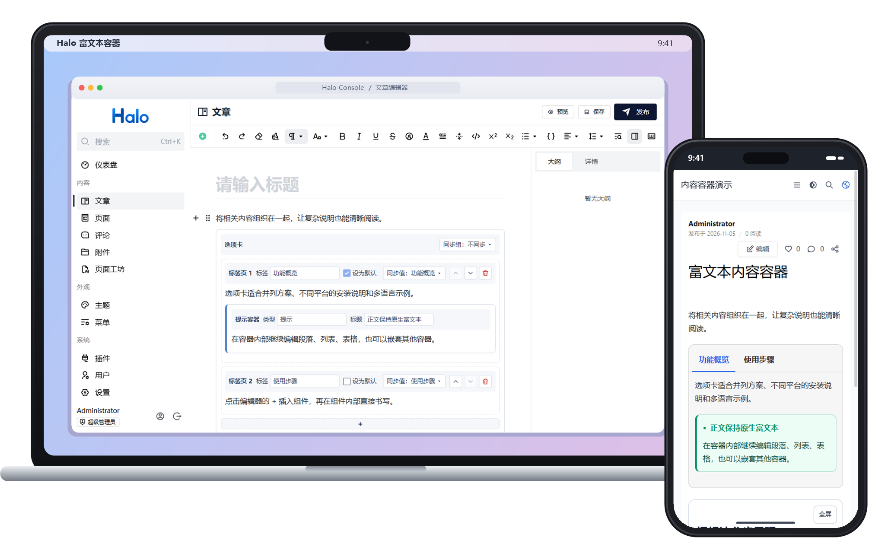
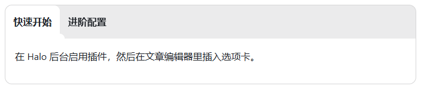
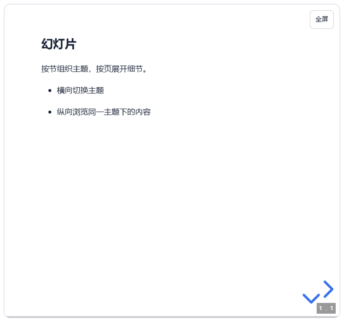
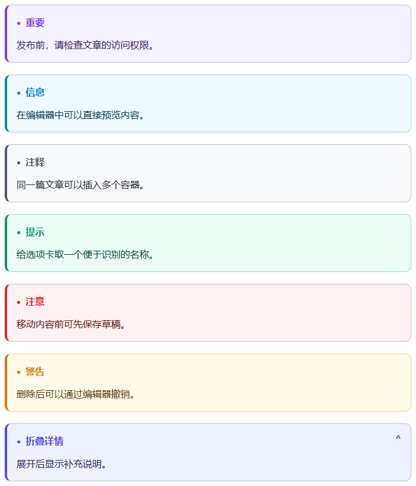
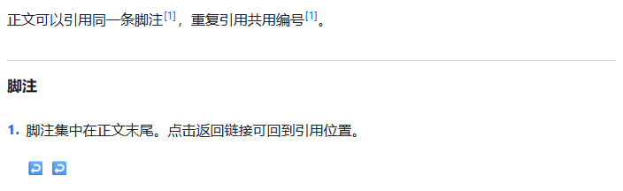
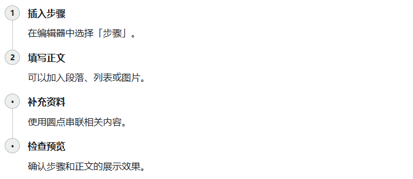

<div align="center">


# 🧩 富文本内容容器

Halo 原生支持的选项卡、幻灯片、提示容器、脚注和步骤

作者：[shenbourne](https://github.com/shenbourne) · 插件标识：`richtext-containers` · 版本：`1.1.0` · 许可证：[GPL-3.0](LICENSE)

</div>



为 **Halo 2.27.1 默认富文本编辑器**增加可嵌套的选项卡、幻灯片、提示容器、脚注和步骤。容器正文直接使用原生富文本节点，支持段落、列表、表格和其他已注册的编辑器组件。

## 功能

| 功能 | 用法 |
| --- | --- |
| 选项卡 | 多个富文本标签页、默认标签、同组切换同步、键盘导航 |
| 幻灯片 | 横向切换节、纵向切换页、主题与过渡、页码与进度、独立控件与全屏 |
| 提示容器 | 重要、信息、注释、提示、注意、警告及可折叠详情 |
| 脚注 | 正文引用、富文本定义、重复引用共用编号、文末列表及返回链接 |
| 步骤 | 用编号或圆点串联步骤，每步可包含段落、代码、图片和嵌套列表 |

容器可以相互嵌套。在光标处选择「脚注」会插入行内引用，并在当前文段下方建立内容框；选择「脚注引用」只会插入引用，可以从下拉菜单选取已有脚注的名称。名称只在编辑时使用，改名不会断开引用。前台按首次引用顺序编号，同一脚注重复引用共用编号，脚注列表位于正文末尾，悬停或键盘聚焦引用可预览文字。


### 选项卡

**选项卡**适合并排介绍同一主题的多种方案，例如不同系统的安装方式。读者可以在原处切换查看。



### 幻灯片

**幻灯片**适合把较长的演示拆成多个主题。读者横向切换到下一节，也可以纵向浏览同一节里的多页内容。



### 提示容器

**提示容器**让重要提醒、实用建议和补充说明从正文中突出。较长的补充内容可以放在折叠详情里，按需展开。



### 脚注

**脚注**适合补充资料来源或术语解释。读者可以在正文引用处预览说明，也可以跳到文末查看完整内容。



### 步骤

**步骤**适合呈现安装教程或操作流程。每一步都能独立填写标题和正文，并用编号或圆点串联起来。




在插入菜单选择「步骤」，每步可填写标题和富文本正文，通过底部「+」添加，使用右侧图标调整顺序或删除。在「列表类型」切换编号和圆点。

## 开发与构建

需要 Java 21、Node.js 24、`ui/package.json` 声明的 pnpm，以及浏览器测试使用的 Chrome。插件工程直接位于仓库根目录，`src/` 是后端，`ui/` 是控制台扩展与阅读端。

```powershell
pnpm --dir ui install --frozen-lockfile
.\gradlew.bat clean build
```

Linux/macOS 使用 `bash gradlew clean build`。无系统 Chrome 的 CI 可执行 `pnpm --dir ui exec playwright install --with-deps chromium`，并设置 `PLAYWRIGHT_CHANNEL=chromium`。

完整构建会运行前端类型检查、单元测试、浏览器测试、后端测试和 JAR 校验。安装包位于 `build/libs/`，后端测试报告位于 `build/reports/tests/test/`。

`pnpm --dir ui dev` 监视并重建控制台扩展；在 Halo 开发实例中预览。可用 `gradlew haloServer` 启动 Halo（需要 Docker）。阅读端资源用 `pnpm --dir ui build` 重建。

GitHub Actions 在推送新版本标签后自动构建、测试并创建 GitHub Release。发布流程见 [应用市场准备](docs/APP_STORE.md)，版本变化见 [更新记录](CHANGELOG.md)。
