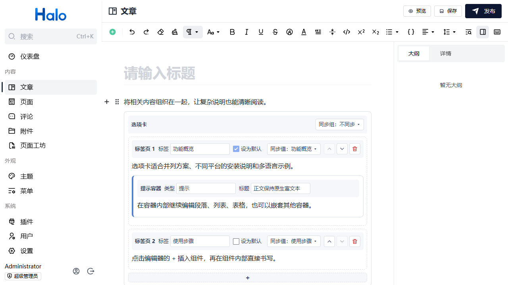
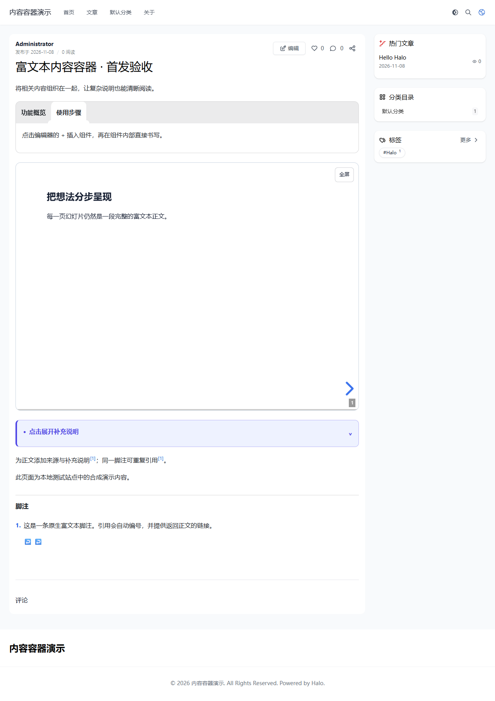

# 富文本内容容器

为 **Halo 2.27.1 默认富文本编辑器**增加可嵌套的选项卡、幻灯片、提示容器和脚注。容器正文直接使用原生富文本节点，支持段落、列表、表格和其他已注册的编辑器组件。

作者：[shenbourne](https://github.com/shenbourne) · 插件标识：`richtext-containers` · 首发版本：`1.0.0` · 许可证：[GPL-3.0](LICENSE)

## 功能

| 功能 | 用法 |
| --- | --- |
| 选项卡 | 多个富文本标签页、默认标签、同组切换同步、键盘导航 |
| 幻灯片 | 横向切换节、纵向切换页、主题与过渡、页码与进度、独立控件与全屏 |
| 提示容器 | 重要、信息、注释、提示、注意、警告及可折叠详情 |
| 脚注 | 正文引用、富文本定义、重复引用共用编号、文末列表及返回链接 |

四类内容可以相互嵌套。在光标处选择「脚注」会插入行内引用，并在当前文段下方建立内容框；选择「脚注引用」只会插入引用，可以从下拉菜单选取已有脚注的名称。名称只在编辑时使用，改名不会断开引用。前台按首次引用顺序编号，同一脚注重复引用共用编号，脚注列表位于正文末尾，悬停或键盘聚焦引用可预览文字。





## 兼容范围

- 以 Halo **2.27.1** 为开发与验收基线，安装范围限定为 `~2.27.1`。后续大版本适配后再扩展范围；实际验收版本见 [发布验收记录](docs/ACCEPTANCE.md)。
- 使用 Halo 默认富文本编辑器；不向 Markdown 编辑器提供容器语法转换。
- 主题需要经过 Halo 标准模板处理链。阅读端资源仅注入文章和独立页面，不注入首页、归档、登录页或控制台。没有采用标准处理链的主题需自行验证。
- KaTeX 或其他第三方节点的编辑与渲染仍需要安装对应插件。本插件没有强制第三方插件依赖。
- 禁用或卸载后原始正文保留，但容器交互和结构化编辑依赖本插件。不要在插件缺失时重新保存含有这些节点的文章。

前台选项卡随文章主题显示。幻灯片可手动选择深色；其自动模式及提示容器跟随系统配色，未跟随所有主题的独立深色开关。

## 安装与配置

1. 备份站点。在 [Releases](https://github.com/shenbourne/halo-plugin-richtext-containers/releases) 下载正式版本 JAR；首次发布前也可按下文自行构建。
2. 在 Halo 控制台「插件」中上传 `richtext-containers-1.0.0.jar`，然后启用。
3. 刷新控制台。插件没有额外设置页面，不需要 API Key、外部账户或修改主题文件。
4. 编辑文章或独立页面，在「插入内容（+）」选择选项卡、幻灯片、提示容器、脚注或脚注引用。
5. 在容器内部直接编辑富文本正文，使用组件中的控件调整标题、标签、幻灯片选项或脚注名称。保存后在预览或已发布页面检查效果。

首次上架后也可通过 Halo 应用市场安装。当前源码未设置市场 `app-id`；应在市场创建真实应用后添加，不能使用占位 ID。

## 升级、版本重置与卸载

`1.0.0` 是本仓库准备首次上架的完整版本，包含全部四类功能。此前本地实验包（包括与正式版同号的早期构建）已退出分发；它们不是本次市场首发制品。原生节点名称及 `data-rc-*=v1` 格式保持不变，已有合法内容继续读取和编辑。

已经安装本地实验包的站点，请先备份；如 Halo 不允许将实验版替换为正式 `1.0.0`，先卸载旧插件，再安装新的 JAR。此过程不需要删除文章或独立页面。停用期间不要重新保存相关正文。完整步骤见 [迁移说明](docs/MIGRATION.md)。

以后正式版本遵循语义化版本号，已公开版本不覆盖制品。正常升级在「插件」中上传更新包，并刷新已打开的控制台及前台页面。

卸载时先停用，再在插件管理中卸载。插件没有自建数据库、定时任务、外部代理或独立业务数据；Halo 负责移除插件资源及扩展注册，文章和独立页面正文不会被插件删除。已打开的页面请刷新，以结束当前页面中已加载的交互。浏览器中保存的同步标签选择不会自动跨客户端清除，详见 [隐私说明](docs/PRIVACY.md)。

## 故障排查

| 现象 | 处理方法 |
| --- | --- |
| 插入菜单没有组件 | 确认已启用、使用默认富文本编辑器，并刷新控制台；查看插件状态与 Halo 日志 |
| 正文有内容但前台没有交互 | 确认主题走标准模板处理链，并检查同源 `/plugins/richtext-containers/assets/frontend/` 下 CSS/JS 是否返回 200 |
| 脚注显示 `?` | 在引用下拉菜单中选取已有脚注；若内容框已删除，重新选择或新建脚注 |
| 公式或第三方组件异常 | 检查相应插件是否安装、启用且兼容当前 Halo |
| 更新后仍是旧界面 | 重新加载页面，并清理反向代理或浏览器针对插件静态资源的缓存 |
| Windows 提示同名 JAR 被占用 | 本地同版本候选包应先停用、卸载再安装；仍占用时重启测试实例。正式升级使用新版本号及对应文件名 |
| JAR 构建不完整 | 使用普通 `clean build`；`-PskipUi` 仅用于后端诊断，不能作为发布包 |

请在 [GitHub Issues](https://github.com/shenbourne/halo-plugin-richtext-containers/issues) 附上 Halo/插件版本、复现步骤及脱敏截图。安全问题请遵循 [SECURITY.md](SECURITY.md)。

## 数据、费用与授权

插件免费，不需要外部商业授权。没有遥测、广告、AI 请求、远程配置或核心代码下载。正文保存在 Halo 原生内容中；浏览器只为同步标签保存选择值，不上传正文或访问记录。详见 [隐私说明](docs/PRIVACY.md)。

插件在官方 [plugin-starter](https://github.com/halo-dev/plugin-starter) 提供的工程方式上开发，不是其他容器插件的改名发行。Halo/Vue 运行时由宿主提供；Reveal.js 和 fitty 随阅读端打包，保留其 MIT 授权。Logo 为本仓库原创 SVG，与本项目按 GPL-3.0 提供。完整第三方声明见 [THIRD-PARTY-NOTICES.md](THIRD-PARTY-NOTICES.md)。

## 开发与构建

需要 Java 21、Node.js 24、`ui/package.json` 声明的 pnpm，以及浏览器测试使用的 Chrome。插件工程直接位于仓库根目录，`src/` 是后端，`ui/` 是控制台扩展与阅读端。

```powershell
pnpm --dir ui install --frozen-lockfile
.\gradlew.bat clean build
```

Linux/macOS 使用 `bash gradlew clean build`。无系统 Chrome 的 CI 可执行 `pnpm --dir ui exec playwright install --with-deps chromium`，并设置 `PLAYWRIGHT_CHANNEL=chromium`。

完整构建会执行前端类型检查、前端单元/浏览器测试、后端测试和最终 JAR 资源/元数据检查。`plugin.yaml` 的版本从 Gradle 注入；JAR 和 Manifest 使用同一版本。结果位于 `build/libs/`，后端报告位于 `build/reports/tests/test/`。仅执行 `pnpm --dir ui build` 不代表完成全部验证。

`pnpm --dir ui dev` 监视并重建控制台扩展；需要配合 Halo 开发实例，不是独立网页预览。`gradlew haloServer` 使用开发工具启动 Halo，需 Docker。前台修改使用 `pnpm --dir ui build` 重建。

CI 运行完整检查；CD 仅在手动发布 GitHub Release 时构建并上传资产，首次审核前不会自动发布到应用市场。提交资料及流程见 [应用市场准备](docs/APP_STORE.md)，版本变化见 [CHANGELOG.md](CHANGELOG.md)。
